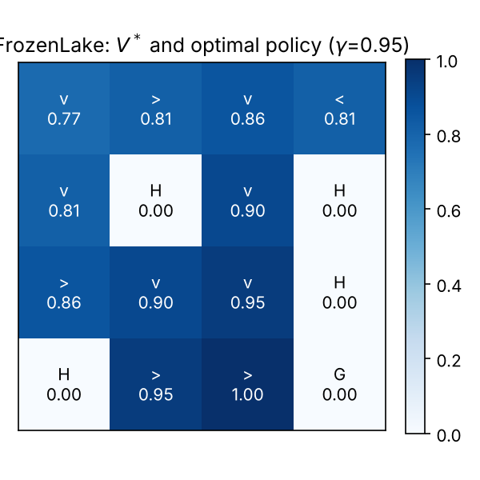
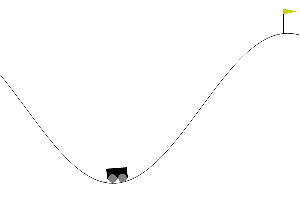
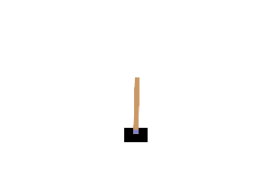
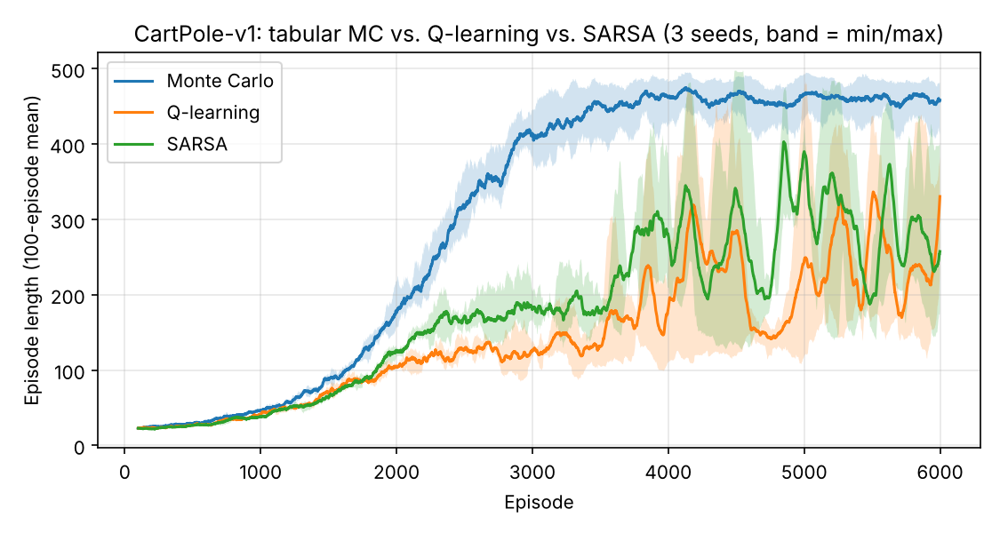

# Tabular reinforcement learning

Python, [Gymnasium](https://gymnasium.farama.org/). From HW4 Q6, HW5 Q6–Q7 and the comprehensive exercise Q1.

| Script | What it does | Result |
|---|---|---|
| [`frozenlake.py`](frozenlake.py) | Deterministic FrozenLake 4×4 solved six ways: policy iteration, value iteration, on-policy first-visit Monte Carlo, off-policy Monte Carlo (weighted importance sampling), SARSA, Q-learning | All six greedy policies reach the goal in 100% of rollouts. PI and VI converge in 7 iterations. The model-free policies pick an optimal action in 10–11 of the 11 non-terminal states |
| [`mountain_car_qlearning.py`](mountain_car_qlearning.py) | Q-learning on MountainCar-v0 with a 20×20 state grid | Greedy policy reaches the flag from 100 of 100 random starts, median 137 steps |
| [`cartpole_mc_q_sarsa.py`](cartpole_mc_q_sarsa.py) | Every-visit Monte Carlo, Q-learning and SARSA on CartPole-v1, same grid and schedule, 3 seeds each | See below |

<p align="center">
  
  
  
</p>

**CartPole.** Greedy policies, mean balance time over 50 test episodes (500 is the episode limit):

| Method | Seed 0 | Seed 1 | Seed 2 |
|---|---|---|---|
| Monte Carlo | 459.5 | 478.4 | 430.6 |
| Q-learning | 500.0 | 500.0 | 186.2 |
| SARSA | 500.0 | 257.8 | 296.0 |

Q-learning and SARSA can reach the limit, but with a fixed step size on a coarse grid the result depends a lot on the seed. Monte Carlo averages complete returns and was the most consistent of the three here.



## Fixed when re-running

- **FrozenLake:** the four HW4 methods and the HW5 SARSA script are now one file with one shared check against value iteration. The SARSA script was a Colab export (`!pip` line) and its "Q-table heatmap" figure was empty. Greedy actions now break ties at random, because with an all-zero Q-table `argmax` always picks "left".
- **MountainCar:** cells were indexed as `pos*20 + vel` although `np.digitize` gives 21 indices per axis, so neighbouring cells shared Q-values.
- **CartPole:** the notebook's 60×60×120×120 grid needed a Q-table of about 10⁸ entries, most never visited. Now 3×3×12×12.

## Run

```bash
pip install -r ../requirements.txt
python frozenlake.py            # ~10 s
python mountain_car_qlearning.py   # a few minutes
python cartpole_mc_q_sarsa.py      # ~20 minutes (9 training runs)
```
