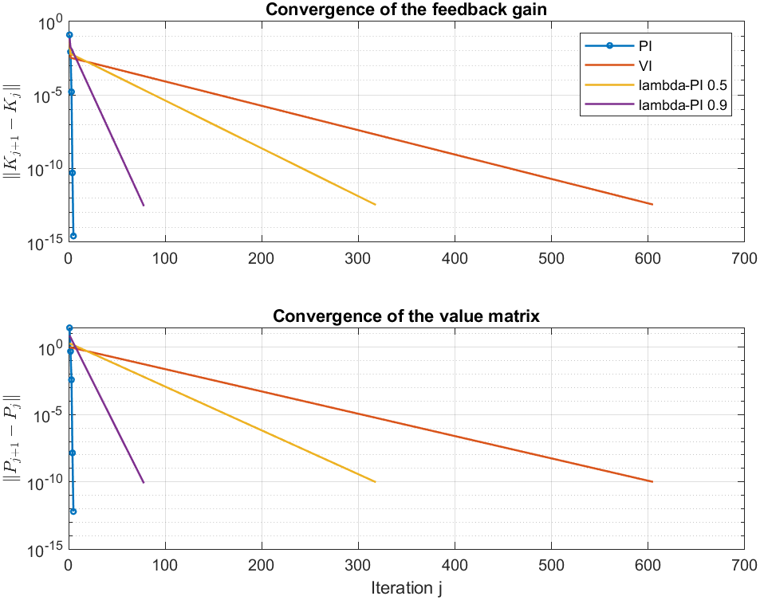
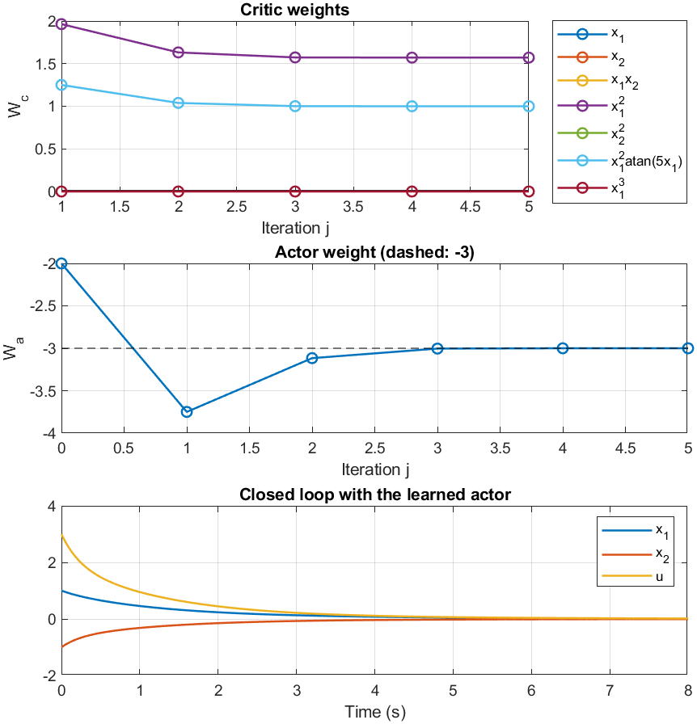
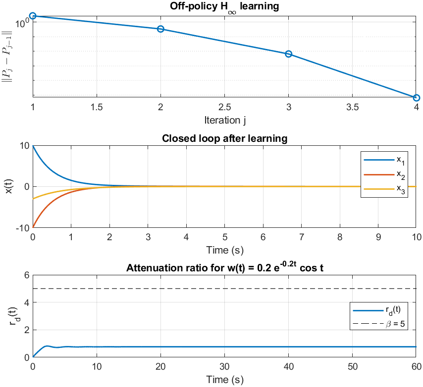
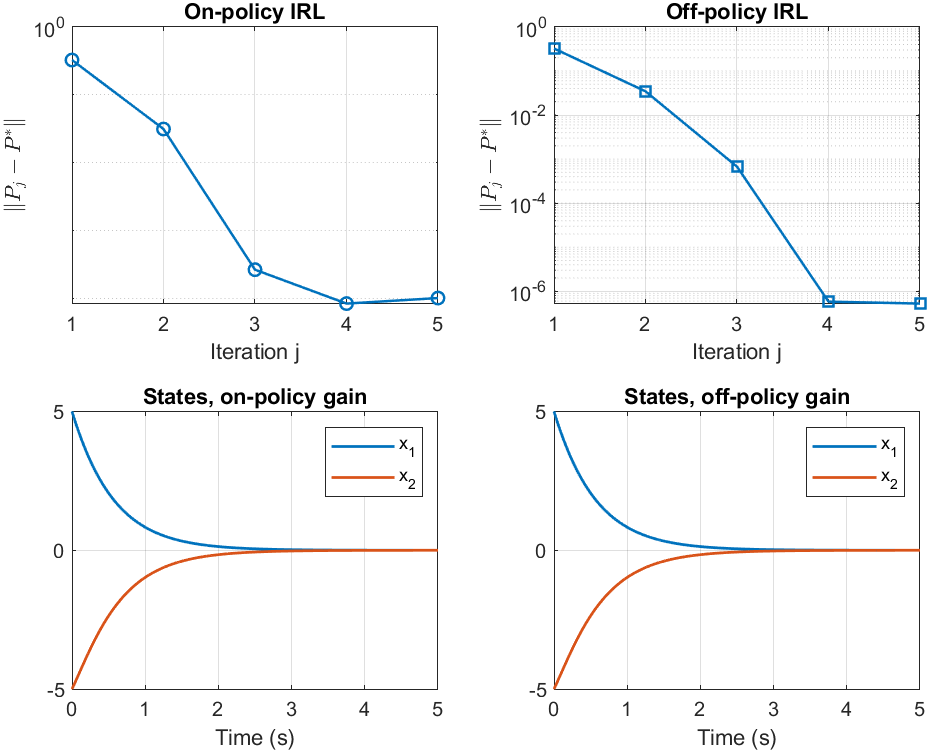

# Reinforcement learning for optimal control

MATLAB R2023b (Control System Toolbox). From HW6, HW7, HW8 and the comprehensive exercise Q2. Every example has a known exact answer (a Riccati equation or a closed-form optimal value function), and each script checks the learned controller against it.

| Script | Method | Plant | Learned vs. exact |
|---|---|---|---|
| [`dt_lqr_pi_vi.m`](dt_lqr_pi_vi.m) | Policy iteration, value iteration, λ-policy iteration (λ = 0.5, 0.9) | 3-state discrete-time LQR | All four reach the DARE gain: PI in 5 iterations, λ = 0.9 in 78, λ = 0.5 in 318, VI in 605 (‖K−K*‖ ≤ 9e-12) |
| [`dt_lqr_qlearning.m`](dt_lqr_qlearning.m) | Model-free Q-learning policy iteration (Bradtke) | same | DARE gain in 4 iterations from data only, ‖K−K*‖ = 6e-15 |
| [`ct_irl_lqr.m`](ct_irl_lqr.m) | On-policy integral RL (Vrabie et al., 2009); A is never used | 3-state continuous-time LQR | CARE gain in 4 iterations, ‖P−P*‖ = 3e-7 |
| [`ct_offpolicy_hinf.m`](ct_offpolicy_hinf.m) | Model-free off-policy RL for H∞ control (zero-sum game), β = 5 | same, plus a disturbance input | Game Riccati solution in 3 iterations, ‖P−P*‖ = 2e-5. Measured attenuation 0.77, below the bound β = 5 |
| [`ct_actor_critic.m`](ct_actor_critic.m) | Actor-critic in continuous time (integral policy iteration with a 7-term critic and a 1-term actor) | 2-state nonlinear plant with a known optimum | Critic weights equal the ideal [0 0 0 π/2 1 1 0] to 4 decimals; actor weight −3.00003 (ideal −3) |
| [`irl_on_off_policy.m`](irl_on_off_policy.m) | On-policy and off-policy IRL (Jiang & Jiang, 2012) | unstable 2-state plant | Both reach the CARE gain [1.6180 0.9001]. Off-policy: ‖P−P*‖ = 6e-7. On-policy stalls at 1e-4 because its probing noise biases the estimate; off-policy does not have this problem |
| [`irl_tracking.m`](irl_tracking.m) | Discounted IRL for linear quadratic tracking (Modares & Lewis, 2014) | same, tracking [sin t, cos t] | Gains match the discounted ARE to about 1e-3 for γ = 0.4 and 0.9. The tracking error stays near 0.7: with a discount and R = 3 the optimal tracker does not drive the error to zero |

<p align="center">
  
  
</p>
<p align="center">
  
  
</p>

## What I fixed when re-running

Most of the submitted scripts ran, but several did not compute what the assignment asked for. I rewrote them to follow the algorithms in the course notes and the cited papers:

- **HW6 value iteration** solved a Lyapunov equation at every step, which is policy iteration again. It now uses the value-iteration recursion. **λ-PI** mixed two P matrices instead of solving the λ-PI equation given in the assignment. Q2 used the plant model in the policy update; it is now model-free Q-learning.
- **HW7 Q1** solved the Lyapunov equation with the model, so it was Kleinman's algorithm, not IRL. It now learns P from measured data.
- **HW7 Q2** compared against the plain LQR Riccati equation, which leaves out the disturbance, and its least-squares problem was not the off-policy Bellman equation. It now solves the game Riccati equation for the reference and uses the off-policy integral Bellman equation, which needs no model.
- **HW8** used a critic basis that differed from the assignment (x₁²x₂² and atan 5x₁ instead of x₂² and x₁² atan 5x₁) and a Bellman error that mixed discrete and continuous time. Its result could not match the known optimum.
- **Comprehensive Q2(c)**, off-policy IRL, used target-policy terms with a gain limiter and a forced positive-definite P instead of the off-policy equation. **Q2(d)** dropped the reference dynamics. It now uses the augmented state [e; x_d] from Modares & Lewis.

Each script runs on its own in about 10 s:

```matlab
dt_lqr_pi_vi
ct_offpolicy_hinf
```
