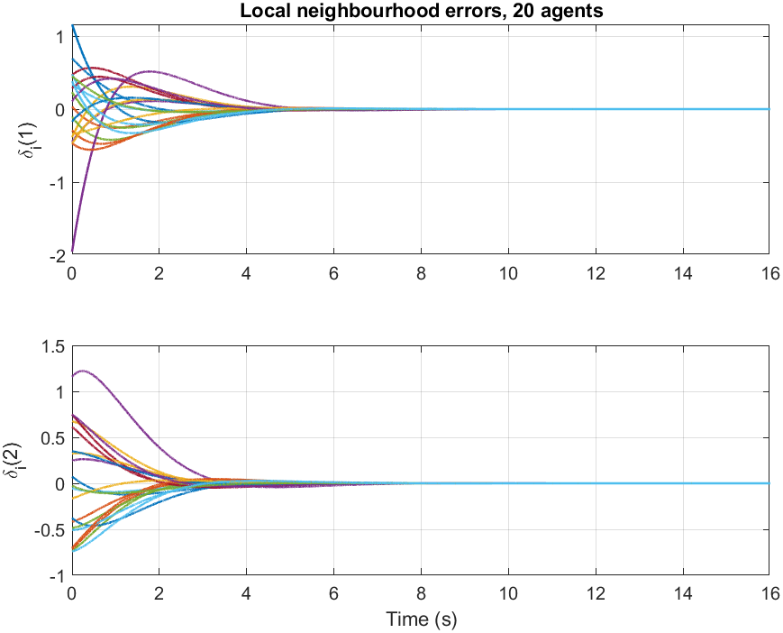
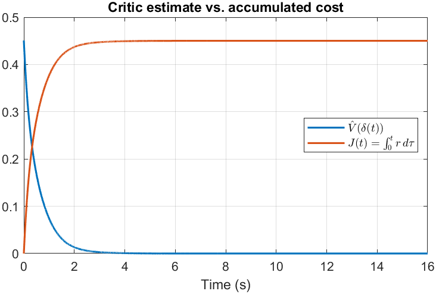

# Course project: model-free RL for fully cooperative consensus

Joint course project with **Kimia Aghili**. We studied and reproduced

> H. Wang and M. Li, "Model-Free Reinforcement Learning for Fully Cooperative Consensus Problem of Nonlinear Multiagent Systems," *IEEE Transactions on Neural Networks and Learning Systems*, 2020. doi:[10.1109/TNNLS.2020.3042508](https://doi.org/10.1109/TNNLS.2020.3042508)

N agents with dynamics ẋᵢ = f(xᵢ) + g(xᵢ)uᵢ talk over a directed graph. All of them minimise **one shared cost** of the local neighbourhood errors δᵢ = Σⱼ eᵢⱼ(xᵢ − xⱼ) and the inputs. The paper turns this into a coupled HJB equation, solves it by policy iteration, and makes the policy iteration **model-free** with an off-policy integral Bellman equation (its eq. 20): data collected once under an exploring input are reused to evaluate and improve every new policy, with a critic network for the shared value and one actor network per agent.

[`fc_consensus_irl.m`](fc_consensus_irl.m) implements the paper's Algorithm 3, solving eq. (20) by least squares over many intervals. The model is only used to simulate the agents, never in the learning step.

## Results

| Example | Consensus (‖δ‖ < 0.01) | Critic estimate V̂(δ(0)) | Measured cost J | Gap | Paper |
|---|---|---|---|---|---|
| Linear check: 5 agents, Fig. 1 graph, linear stable agents | 6.2 s | 1.3398 | 1.3245 | 1.2% | (not in paper) |
| 5 nonlinear agents, Fig. 1 graph (Sec. V-A.1) | 6.5 s | 0.4509 | 0.4501 | 0.18% | about 6 s, gap 0.83% |
| 20 nonlinear agents, Fig. 4 graph (Sec. V-A.2) | 7.5 s | 5.3070 | 5.2529 | 1.0% | about 8 s, gap 0.29% |

<p align="center">
  
  
</p>

**The linear check** exists because its optimum is known exactly. The centralised Riccati equation gives V* = 1.3233, and the learned distributed controller achieves J = 1.3245, within 0.1%. The remaining 1% gap between V̂ and J comes from the structure the paper imposes: each agent's actor only sees its own error and the errors of the agents that listen to it, while the exact centralised optimum uses every agent's error. Allowing a centralised actor in a test closed that gap.

**In both nonlinear examples** the learned controller costs about the same as no control at all (J = 0.4501 against 0.4520 for u = 0, and 5.2529 against 5.2573). This is a property of the examples, not of the method: the agents in eq. (36) are stable on their own, and the input weights R = 10 and R = 200 make control expensive, so the optimal input is small. The value of the method here is that the critic predicts the cost of the closed loop to within 1% without a model.

The paper does not give the initial states or the network activation functions, so the start states and the bases here are my own choices: quadratic terms of δ for the critic (plus quartic terms in the five-agent case, whose cost is quartic), and each agent's error and its listeners' errors for the actor (plus a copy multiplied by sin xᵢ₁, the agent's own input gain).

## Run

```matlab
run_examples      % all three examples and their figures, about 1 minute
res = fc_consensus_irl('five');            % one example
res = fc_consensus_irl('twenty', 'nRuns', 60);
```

## About the code

The script submitted with the project in Bahman 1403 did not implement the paper: it had no communication graph, the actor update was a random step, and the critic was a discrete-time TD(0) update rather than the integral Bellman equation. I rewrote it from the paper for this repository (Aban 1405). The project report (in Persian, written with Kimia) is not included.
