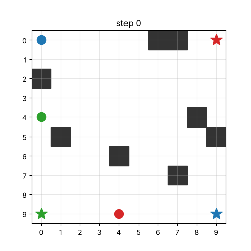
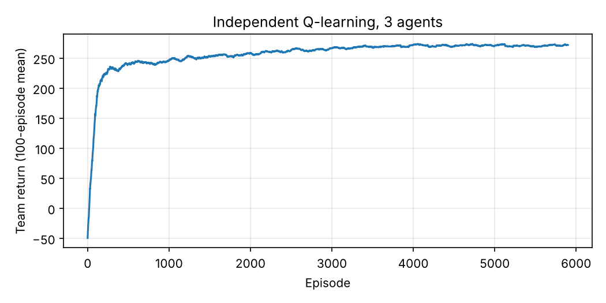

# Seminar: multi-agent reinforcement learning

My class seminar on MARL. This folder has the demo I wrote for it: **independent Q-learning** for three agents on a 10×10 grid with eight obstacles. Each agent learns its own Q-table over its own cell and has its own goal; another agent standing in the way blocks the move. It is the simplest MARL baseline, and it shows the main difficulty the seminar was about: each agent treats the others as part of the environment, so from its point of view the environment keeps changing while they learn.

After 6,000 training episodes, the greedy policies bring all three agents to their goals from **98% of 200 random start configurations**, in a median of 13 steps.

<p align="center">
  
  
</p>

Changes from the seminar notebook: an agent that reaches its goal now stops there (in the original it kept collecting the goal reward at every step), blocked moves cost a little more than ordinary steps, the run is reproducible, and the policies are tested from many random starts instead of one.

```bash
python marl_independent_q.py   # a few seconds
```
