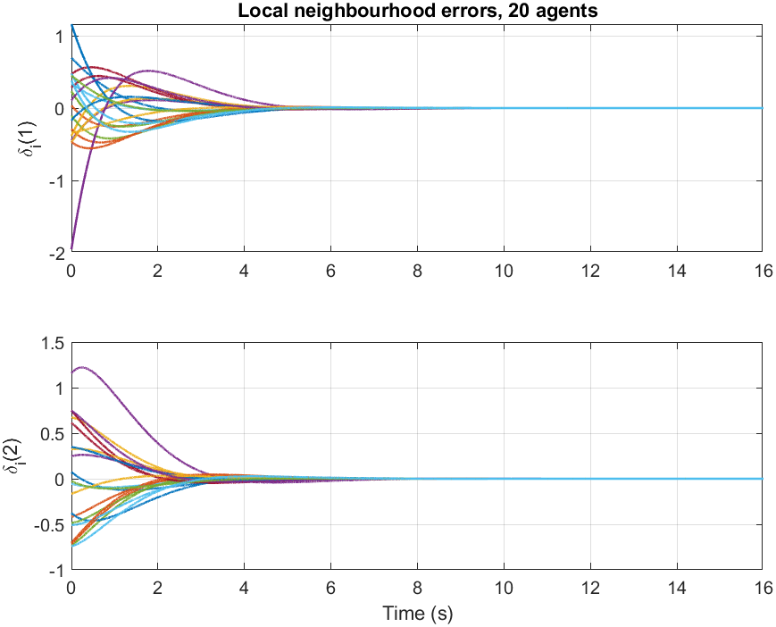
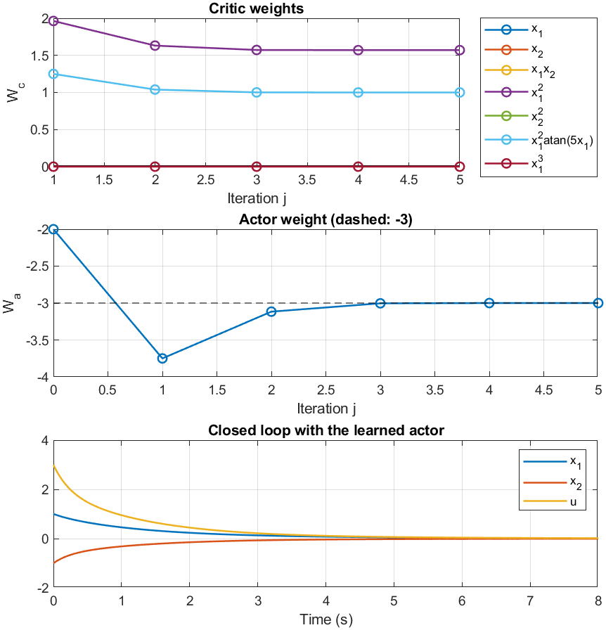

<h1 align="center">Reinforcement-Learning-Coursework</h1>

<p align="center">
  Reinforcement learning for control: tabular methods, integral RL, off-policy H∞ learning, actor-critic, and a model-free multi-agent consensus project.
  <br>
  From the graduate course <em>Reinforcement Learning</em> (Dr. Saeed Shamaghdari), MSc in Electrical Engineering (Control) at
  <a href="https://www.iust.ac.ir/">Iran University of Science and Technology</a>, Autumn 1403 (2024).
</p>

<p align="center">
  
  
  
  
  
</p>

<p align="center">
  
  
</p>
<p align="center"><sub>
  Left: twenty agents reach consensus under controllers learned without a model (course project). Right: a continuous-time actor-critic converging to the known optimal weights (HW8).
</sub></p>

---

## What's in here

I kept the assignments with results worth showing and left out the purely written ones and the installation exercise. Every result below was re-generated by running the code in this repository, and each folder has a README and an English summary in LaTeX (`report_en.pdf`).

| Folder | Language | Highlights |
|---|---|---|
| [**01-Tabular-RL**](01-Tabular-RL/) | Python | FrozenLake solved six ways (PI, VI, on/off-policy Monte Carlo, SARSA, Q-learning); MountainCar Q-learning; Monte Carlo vs. Q-learning vs. SARSA on CartPole over three seeds |
| [**02-RL-for-Optimal-Control**](02-RL-for-Optimal-Control/) | MATLAB | PI, VI and λ-PI for discrete-time LQR; model-free Q-learning; integral RL (on- and off-policy); off-policy H∞ control; continuous-time actor-critic; discounted IRL tracking. Each one checked against the exact Riccati or closed-form solution |
| [**03-Project-Cooperative-Consensus-IRL**](03-Project-Cooperative-Consensus-IRL/) | MATLAB | Reproduction of Wang & Li (IEEE TNNLS, 2020): model-free off-policy IRL for the fully cooperative consensus of nonlinear multi-agent systems, 5 and 20 agents. Joint project with Kimia Aghili |
| [**04-Seminar-MARL**](04-Seminar-MARL/) | Python | My seminar demo: independent Q-learning for three agents on a grid with obstacles |

## Re-running the code

When I re-ran the submitted code for this repository, several scripts did not compute what the assignment asked for, and the project script did not implement the paper. I fixed them to follow the course notes and the cited papers; each folder's README lists what changed. The problem statements, lecture slides, textbooks, papers and my Persian reports are not included.

## How to run

- **MATLAB R2023b** with the Control System Toolbox for folders 02 and 03. Each script runs on its own.
- **Python 3.10+** for folders 01 and 04:

```bash
pip install -r requirements.txt
cd 01-Tabular-RL && python frozenlake.py
```

## Repository layout

```
├── 01-Tabular-RL/                         Python scripts, figures, README, report_en.tex/pdf
├── 02-RL-for-Optimal-Control/             MATLAB scripts, figures, README, report_en.tex/pdf
├── 03-Project-Cooperative-Consensus-IRL/  fc_consensus_irl.m, run_examples.m, figures, README, report_en.tex/pdf
├── 04-Seminar-MARL/                       marl_independent_q.py, figures, README
├── tex/preamble.tex                       shared LaTeX preamble
└── requirements.txt
```

## License

[MIT](LICENSE) for my code and write-ups.
